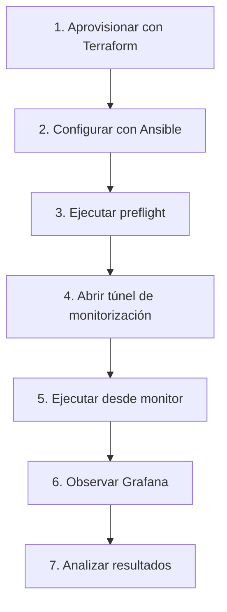

# SIS_DISTRIBUIDOS — Monitoreo de Tolerancia a Fallos de Apache Kafka (AWS EC2)

Sistema completo para **aprovisionar**, **desplegar**, **ejecutar experimentos** y **analizar** la tolerancia a fallos de un clúster de Apache Kafka de 3 nodos (modo KRaft), sobre instancias AWS EC2, con monitoreo vía Prometheus + Grafana accesible desde tu máquina local mediante túneles SSH.

---

## 📋 Tabla de Contenidos

1. [Arquitectura y Componentes](#arquitectura-y-componentes)
2. [Requisitos Previos](#requisitos-previos)
3. [Flujo de Trabajo](#flujo-de-trabajo)
4. [Despliegue (Terraform + Ansible)](#despliegue-terraform--ansible)
5. [Conexión y Acceso](#conexión-y-acceso)
6. [Aplicaciones de Prueba (Producer/Consumer)](#aplicaciones-de-prueba)
7. [Escenarios de Experimento](#escenarios-de-experimento)
8. [Ejecución de Pruebas](#ejecución-de-pruebas)
9. [Análisis de Métricas y Eficiencia](#análisis-de-métricas-y-eficiencia)
10. [Estructura del Proyecto](#estructura-del-proyecto)
11. [Comandos Útiles](#comandos-útiles)

---

## 🏗️ Arquitectura y Componentes

```
                     TU MÁQUINA LOCAL (analista)
                           │  túneles SSH (ssh -L)
                           ▼
         ┌────────────────────────────────────────────────────────┐
         │                    AWS / EC2                           │
         │                                                        │
         │  ┌──────────┐  ┌──────────┐  ┌──────────┐   ┌─────┐   │
         │  │ kafka-1  │  │ kafka-2  │  │ kafka-3  │   │moni │   │
         │  │ node.id 1│  │ node.id 2│  │ node.id 3│   │     │   │
         │  │          │◄►│          │◄►│          │   │     │   │
         │  │  9092    │  │  9092    │  │  9092    │   │ 9090│   │
         │  │  9093    │  │ 9093    │  │ 9093    │   │ 3000│   │
         │  └────┬─────┘  └────┬─────┘  └────┬─────┘   │9308│   │
         │       └─────────────┴────────┴────┴─────────┴────┴───┘
         └────────────────────────────────────────────────────────┘
```

### Tabla de Componentes

| VM | Rol | vCPU | RAM | Puertos clave |
|---|---|---|---|---|
| kafka-1/2/3 | Broker + Controller (KRaft) | 2 | 4 GB | 9092 (cliente), 9093 (quórum), 9100 (JMX) |
| monitor | Prometheus + Grafana + exporters | 2 | 8 GB | 9090 (Prometheus), 3000 (Grafana), 9308 (kafka_exporter) |

> Instâncias atuais: brokers `c7i-flex.large` e `monitor` `m7i-flex.large`
> (Ubuntu 24.04.5). O Terraform do TP1 usa por padrão 4× `t3.medium` com
> Ubuntu 22.04; o TP2 exige apenas Python 3.10+ e funciona em ambos.

### Componentes Clave

| Componente | Tecnología | Propósito |
|---|---|---|
| Clúster Kafka | Apache Kafka 3.7.2 (KRaft) | Mensajería distribuida con tolerancia a fallos |
| Prometheus | 2.48.0 | Scraping de métricas y almacenamiento de series temporales |
| Grafana | 13.2.2 | Visualización y dashboards interactivos |
| kafka-exporter | 1.7.0 | Métricas específicas de Kafka (consumer lag, etc.) |
| JMX Exporter | 1.0.1 | Exposición de métricas JMX de Kafka |
| Experiment Runner | Python 3 | Orquestación de experimentos y generación de reportes |

---

## 📦 Requisitos Previos

### En tu máquina local

```bash
# Dependencias Python
pip install -r scripts/app/requirements.txt

# O crear entorno virtual
python3 -m venv .venv && source .venv/bin/activate
pip install -r scripts/app/requirements.txt
```

### En AWS EC2

- Instancias actuales: 3 brokers `c7i-flex.large` (2 vCPU, 4 GB) y 1 `monitor` `m7i-flex.large` (2 vCPU, 8 GB) con Ubuntu 24.04 LTS
  (Terraform por defecto crea 4× `t3.medium` con Ubuntu 22.04)
- Key pair SSH configurada
- Security Groups ajustados (ver sección de requisitos de red)
- Terraform >= 1.6 (opcional, si deseas crear las VMs)
- Ansible >= 2.14
- `python3-venv` y `python3-pip` instalados en la VM monitor

### Direcciones actuales de las VMs

Las IP públicas de AWS cambian al detener e iniciar las instancias. Las IP
privadas actuales se mantienen estables y son las que Kafka usa internamente.

| VM | IP pública actual | IP privada actual |
|---|---|---|
| kafka-1 | `77.113.217.182` | `172.31.33.149` |
| kafka-2 | `18.117.194.94` | `172.31.46.215` |
| kafka-3 | `77.113.80.88` | `172.31.38.92` |
| monitor | `18.218.241.188` | `172.31.43.232` |

Histórico de IPs públicas:

| Estado | kafka-1 | kafka-2 | kafka-3 | monitor |
|---|---|---|---|---|
| Inicial | `18.221.175.73` | `18.224.202.67` | `18.218.4.132` | `3.15.43.44` |
| Primer reinicio | `18.191.138.84` | `18.222.141.148` | `52.14.10.119` | `18.225.222.106` |
| Actual | `3.16.114.25` | `77.113.93.214` | `18.222.169.115` | `18.219.192.134` |
| Segundo reinicio | `18.225.31.122` | `3.22.234.84` | `18.222.141.214` | `18.220.154.71` |
| Tercer reinicio | `77.113.217.182` | `18.117.194.94` | `77.113.80.88` | `18.218.241.188` |

Después de cada cambio de IP pública hay que actualizar el inventario y
reaplicar Ansible. Las IP privadas solo se cambian si AWS también las cambia.

---

## 🔄 Flujo de Trabajo



### Resumen rápido

1. **Aprovisionar** → Terraform solo si las VMs no existen.
2. **Configurar** → ejecutar Ansible con el inventario actualizado.
3. **Preflight** → verificar Prometheus, Kafka, topic y targets.
4. **Monitorizar** → abrir túnel solo para Grafana, Prometheus y exporter.
5. **Experimentar** → ejecutar el runner remoto desde `monitor`.
6. **Analizar** → revisar Grafana, JSON, CSV y reporte HTML.

---

## 🚀 Despliegue (Terraform + Ansible)

### Opción A: Crear infraestructura nueva (si las VMs no existen)

```bash
# 1. Configurar variables
cd terraform
cp variables.tf terraform.tfvars  # Editar con tu clave SSH y otros valores

# 2. Inicializar y aplicar
terraform init
terraform apply -auto-approve
```

### Opción B: Usar VMs existentes (más común)

1. Crea el inventario local desde la plantilla y edítalo con las IPs de tus VMs.
  El inventario real está excluido de Git para no publicar direcciones ni
  configuración específica de AWS:

```bash
cp ansible/inventories/hosts.example.yml ansible/inventories/hosts.yml
```

Edita `ansible/inventories/hosts.yml`:

```yaml
brokers:
  hosts:
    kafka-1:
      ansible_host: "IP_PUBLICA_KAFKA1"
      broker_ip: "IP_PRIVADA_KAFKA1"
      node_id: 1
    kafka-2:
      ansible_host: "IP_PUBLICA_KAFKA2"
      broker_ip: "IP_PRIVADA_KAFKA2"
      node_id: 2
    kafka-3:
      ansible_host: "IP_PUBLICA_KAFKA3"
      broker_ip: "IP_PRIVADA_KAFKA3"
      node_id: 3

monitor:
  hosts:
    monitor:
      ansible_host: "IP_PUBLICA_MONITOR"
      broker_ip: "IP_PRIVADA_MONITOR"
```

2. Configurar clave SSH:

```bash
export SSH_PRIVATE_KEY=/home/gruner-sanchez/Descargas/SSH/kafka-cluster-key.pem
```

3. Ejecutar playbook:

```bash
cd ansible
ansible-playbook -i inventories/hosts.yml site.yml
```

---

## 🔌 Conexión y Acceso

### Abrir túneles SSH

```bash
# Con IP del monitor (obtenla de terraform output o inventory)
./scripts/tunnels.sh 18.220.154.71

# O manualmente:
ssh -i /home/gruner-sanchez/Descargas/SSH/kafka-cluster-key.pem ubuntu@IP_MONITOR \
  -L 3000:localhost:3000 \
  -L 9090:localhost:9090 \
  -L 9308:localhost:9308 \
  -N
```

### URLs de acceso

| Servicio | URL |
|---|---|
| Grafana | `http://localhost:3000` |
| Prometheus | `http://localhost:9090` |
| Kafka Exporter | `http://localhost:9308` |

### Credenciales Grafana

- Usuario: `admin`
- Contraseña: `admin`

Para observar los experimentos, abre un túnel únicamente para los servicios de
monitorización. Los clientes Kafka se ejecutan dentro de `monitor` y no
necesitan un forward local de `9092`:

```bash
ssh -o ExitOnForwardFailure=yes \
  -i /home/gruner-sanchez/Descargas/SSH/kafka-cluster-key.pem \
  -L 3000:127.0.0.1:3000 \
  -L 9090:127.0.0.1:9090 \
  -L 9308:127.0.0.1:9308 \
  ubuntu@18.220.154.71 -N
```

Abre `http://127.0.0.1:3000` en el navegador.

---

## 📦 Aplicaciones de Prueba (Producer/Consumer)

Las aplicaciones están en `scripts/app/`:

### order-producer.py

Productor de mensajes con alta durabilidad (`acks=all`).

```bash
python3 scripts/app/order-producer.py \
  --bootstrap kafka-1:9092 \
  --rate 10 \
  --duration 300 \
  --topic orders
```

**Parámetros:**
- `--bootstrap`: Servidor Kafka de entrada
- `--rate`: Mensajes por segundo (default: 2)
- `--duration`: Duración en segundos (0 = infinito)
- `--topic`: Nombre del topic

### order-consumer.py

Consumidor que procesa pedidos y detecta duplicados.

```bash
python3 scripts/app/order-consumer.py \
  --bootstrap kafka-1:9092 \
  --group order-processor-group \
  --topic orders \
  --duration 300
```

**Parámetros:**
- `--bootstrap`: Servidor Kafka de entrada
- `--group`: Nombre del consumer group
- `--topic`: Nombre del topic
- `--duration`: Duración en segundos (0 = infinito)

---

## 🧪 Escenarios de Experimento

Los escenarios están en `experiments/scenarios/`:

### 1. broker-failure.yaml

**Legado:** mezcla fallos individuales, pares y triple caída. No usarlo para
resultados comparables; usar la matriz separada descrita más abajo.

```yaml
# Experimento: broker-failure
# - Línea base: 60s sin fallos
# - Fallo: broker 2 cae a los 60s por 45s
# - Recuperación: 90s de observación
producer_rate: 8  # msgs/seg
baseline_seconds: 60
recovery_seconds: 90
faults:
  - kind: broker-failure
    at: 60.0
    broker: 3.22.234.84
    down_for: 45.0
    restart: true
```

### 2. full-restart.yaml

**Objetivo:** Medir durabilidad ante reinicio completo del clúster

```yaml
producer_rate: 6
baseline_seconds: 45
recovery_seconds: 60
faults:
  - kind: full-restart
    at: 45.0
    down_for: 30.0
```

### 3. rebalance.yaml

**Objetivo:** Analizar rebalanceo de consumer groups

```yaml
producer_rate: 30
baseline_seconds: 45
recovery_seconds: 60
faults:
  - kind: rebalance
    at: 45.0
    duration: 15.0
  - kind: rebalance
    at: 75.0
    duration: 15.0
  - kind: rebalance
    at: 105.0
    duration: 15.0
  - kind: rebalance
    at: 135.0
    duration: 15.0
```

La configuración actual de `rebalance.yaml` usa 30 msg/s y cuatro ciclos de
15 segundos en `t=45`, `75`, `105` y `135` segundos. Esto permite observar
picos de consumer lag y variaciones de throughput durante cada reasignación.

### 4. Matriz de fallos separada

Cada escenario se ejecuta de forma independiente y vuelve a un estado estable
antes de iniciar otra condición:

| Escenario | Brokers detenidos simultáneamente | Consumer group |
|---|---|---|
| `broker-single-kafka1.yaml` | kafka-1 | `fault-single-kafka1` |
| `broker-single-kafka2.yaml` | kafka-2 | `fault-single-kafka2` |
| `broker-single-kafka3.yaml` | kafka-3 | `fault-single-kafka3` |
| `broker-pair-kafka1-kafka2.yaml` | kafka-1, kafka-2 | `fault-pair-kafka1-kafka2` |
| `broker-pair-kafka1-kafka3.yaml` | kafka-1, kafka-3 | `fault-pair-kafka1-kafka3` |
| `broker-pair-kafka2-kafka3.yaml` | kafka-2, kafka-3 | `fault-pair-kafka2-kafka3` |

El fallo triple se prueba únicamente mediante `full-restart.yaml`.

---

## ▶️ Ejecución de Pruebas

### Ejecutar experimento individual

```bash
cd experiments

# Escenario de caída de broker
python3 experiment_runner.py \
  --scenario scenarios/broker-failure.yaml \
  --out output

# Modo dry-run (sin inyectar fallos)
python3 experiment_runner.py \
  --scenario scenarios/broker-failure.yaml \
  --dry
```

### Ejecución recomendada desde el monitor

Kafka anuncia IPs privadas. El launcher remoto ejecuta productor, consumidor y
runner dentro de la VM monitor, donde esas IPs son accesibles:

```bash
cd "/home/gruner-sanchez/INFORMATICA BR/SIS_DISTRIBUIDOS"
ssh-add /home/gruner-sanchez/Descargas/SSH/kafka-cluster-key.pem

./scripts/run_remote_experiment.sh \
  18.220.154.71 \
  full-restart.yaml
```

El launcher copia los scripts, crea un entorno Python temporal, convierte las
IPs públicas del escenario a IPs privadas, usa `kafka-1:9092` y copia los
resultados a `output/remote-<timestamp>/`. La clave privada no se copia al
monitor.

Para ejecutar la matriz de fallos separada:

```bash
for scenario in \
  broker-single-kafka1.yaml \
  broker-single-kafka2.yaml \
  broker-single-kafka3.yaml \
  broker-pair-kafka1-kafka2.yaml \
  broker-pair-kafka1-kafka3.yaml \
  broker-pair-kafka2-kafka3.yaml; do
  ./scripts/run_remote_experiment.sh 18.220.154.71 "$scenario"
done
```

Antes de una prueba destructiva, ejecuta el preflight:

```bash
.venv/bin/python experiments/experiment_runner.py \
  --scenario experiments/scenarios/full-restart.yaml \
  --preflight
```

### Ejecutar todos los experimentos

```bash
./run_tests.sh

# O manualmente:
python3 experiments/experiment_runner.py --scenario experiments/scenarios/full-restart.yaml
python3 experiments/experiment_runner.py --scenario experiments/scenarios/rebalance.yaml
python3 experiments/experiment_runner.py --scenario experiments/scenarios/broker-failure.yaml
```

### Ver resultados

```bash
# Resumen JSON con métricas calculadas
cat output/broker-failure/summary.json

# Series temporales crudas (CSV)
cat output/broker-failure/raw_series.csv

# Reporte HTML completo con gráficos
open output/broker-failure/report.html
```

---

## 📊 Análisis de Métricas y Eficiencia

### Métricas principales capturadas

| Métrica | Prometheus | Significado |
|---|---|---|
| **Under-replicated partitions** | `kafka_server_replicamanager_underreplicatedpartitions` | Réplicas desincronizadas (0 = sano) |
| **Offline partitions** | `kafka_controller_kafkacontroller_offlinepartitionscount` | Particiones sin líder (0 = sano) |
| **Active controller** | `kafka_controller_kafkacontroller_activecontrollercount` | 1 = hay controlador activo |
| **ISR shrinks** | `kafka_server_replicamanager_isrshrinks_total` | Pérdida de réplicas en ISR |
| **Bytes de entrada** | `kafka_server_brokertopicmetrics_bytesin_total` | Tráfico recibido por el cluster |
| **Throughput** | `kafka_server_brokertopicmetrics_messagesin_total` | Mensajes/segundo |
| **Consumer lag** | `kafka_consumergroup_lag` (kafka_exporter) | Retraso del consumidor |

### KPIs calculados

| KPI | Fórmula | Interpretación |
|---|---|---|
| **MTTD** (Mean Time To Detect) | Primera muestra con `underreplicated > 0` tras el fallo | Menos es mejor |
| **MTTR** (Mean Time To Recovery) | Primera muestra con `underreplicated = 0` después de la detección | Menos es mejor |
| **Pérdida de mensajes** | IDs confirmados no procesados | 0 = sin pérdida confirmada |
| **Lag pico** | Máximo valor de `consumer_lag` durante el experimento | Menos es mejor |

### Dashboard Grafana (10 paneles)

1. **Under-replicated partitions** - Estado de consistencia
2. **Offline partitions** - Particiones caídas
3. **Active controller** - Sistema de coordinación
4. **Consumer lag** - Retraso en procesamiento
5. **Throughput mensajes** - Carga del sistema
6. **ISR shrinks** - Dinámica de réplicas
7. **Bytes de entrada** - Tráfico recibido por el cluster
8. **Brokers activos** - Estado de los targets Kafka
9. **CPU del monitor** - Presión de CPU
10. **Memoria del monitor** - Presión de memoria

El dashboard usa variables para `topic`, `consumer_group` y `broker`. El
datasource Prometheus usa el UID persistido `PBFA97CFB590B2093`.

En la instalación actual `messagesin_total` no expone etiqueta `topic`, por lo
que el throughput se calcula globalmente. `isrgrows_total` tampoco está
expuesto; por eso el panel de recuperación se sustituyó por bytes de entrada.

### Visualización de eficiencia distribuida

```bash
# Consulta rápida vía curl (requiere túnel en puerto 9090)
curl -s "http://localhost:9090/api/v1/query?query=kafka_server_replicamanager_underreplicatedpartitions" | jq

# Throughput por minuto
curl -s "http://localhost:9090/api/v1/query?query=rate(kafka_server_brokertopicmetrics_messagesin_total[1m])" | jq

# Consumer lag por grupo
curl -s "http://localhost:9090/api/v1/query?query=kafka_consumergroup_lag" | jq
```

### Comparación de escenarios (ejemplo)

| Escenario | MTTD (s) | MTTR (s) | Lag pico | Mensajes perdidos |
|---|---|---|---|---|
| broker-failure | Calculado automáticamente | Calculado automáticamente | Desde raw_series.csv | Desde summary.json |
| full-restart | N/A | N/A | Mayor durante reinicio | 0 (disco persiste) |
| rebalance | N/A | N/A | Transitorio | 0 |

---

## 📁 Estructura del Proyecto

```
.
├── README.md                          # Este archivo
├── PROYECTO_CONTEXTO.md               # Documento de contexto del proyecto
├── PLAN_TEST_GRAFANA.md               # Plan de test para Grafana
├── run_tests.sh                       # Script para ejecutar todos los experimentos
│
├── terraform/                         # Infraestructura AWS EC2 (opcional)
│   ├── main.tf                        # Recurso: instancias, Security Groups
│   ├── variables.tf                   # Variables de configuración
│   ├── outputs.tf                     # Salidas: IPs y comandos de túnel
│   ├── versions.tf                    # Versiones de providers
│   ├── render_inventory.sh            # Genera inventario Ansible
│   └── cloud-init/
│       ├── kafka-node.sh              # Bootstrap de broker Kafka
│       └── monitor-node.sh            # Bootstrap del nodo de monitoreo
│
├── ansible/                           # Configuración principal (VÍA RECOMENDADA)
│   ├── site.yml                       # Playbook principal
│   ├── inventories/
│   │   └── hosts.yml                  # Inventario con IPs de VMs
│   └── roles/
│       ├── broker/                    # Rol para Kafka brokers
│       │   ├── tasks/main.yml         # Instalación y configuración
│       │   ├── templates/
│       │   │   ├── server.properties.j2
│       │   │   └── kafka.service.j2
│       │   └── files/
│       │       └── kafka-jmx-config.yml
│       └── monitoring/                # Rol para VM de monitoreo
│           ├── tasks/main.yml         # Instalación de Prometheus/Grafana
│           └── templates/
│               ├── prometheus.yml.j2
│               ├── prometheus.service.j2
│               ├── grafana-datasources.yml.j2
│               └── kafka-exporter.service.j2
│
├── scripts/
│   ├── tunnels.sh                     # Script para abrir túneles SSH
│   └── app/
│       ├── order-producer.py          # Productor de pedidos
│       ├── order-consumer.py          # Consumidor de pedidos
│       └── requirements.txt           # Dependencias Python
│
├── experiments/
│   ├── experiment_runner.py         # Orquestador de experimentos
│   ├── scenarios/
│   │   ├── broker-failure.yaml      # Escenario: caída de broker
│   │   ├── full-restart.yaml        # Escenario: reinicio completo
│   │   └── rebalance.yaml           # Escenario: rebalanceo
│   └── README.md                    # Documentación de experimentos
│
├── monitor/
│   ├── prometheus/
│   │   └── prometheus.yml.reference # Plantilla referencia
│   ├── grafana/
│   │   └── dashboard-fault-tolerance.json  # Dashboard a importar
│   └── exporters/
│       └── jmx-config.yml           # Config JMX para Kafka
│
└── output/                            # Resultados generados
    ├── broker-failure/
    │   ├── summary.json             # Métricas calculadas
    │   ├── raw_series.csv           # Series temporales
    │   └── report.html              # Reporte con gráficos
    ├── full-restart/
    └── rebalance/
```

---

## 🔧 Configuración de Tolerancia (KRaft)

Los brokers están configurados para tolerar la caída de 1 nodo:

```properties
process.roles=broker,controller
node.id=1 | 2 | 3
controller.quorum.voters=1@kafka-1:9093,2@kafka-2:9093,3@kafka-3:9093
listeners=PLAINTEXT://:9092,CONTROLLER://:9093
num.partitions=3
default.replication.factor=3
min.insync.replicas=2
```

---

## 🌐 Requisitos de Red en AWS (Security Groups)

| Puerto | Origén | Propósito |
|---|---|---|
| 22 | 0.0.0.0/0 | SSH |
| 9092 | 0.0.0.0/0 | Client API / Inter-broker |
| 9093 | 0.0.0.0/0 | Controlador (quórum) |
| 9100 | Security Group monitor | JMX exporter |
| 9090 | 0.0.0.0/0 | Prometheus (túnel) |
| 3000 | 0.0.0.0/0 | Grafana (túnel) |
| 9308 | 0.0.0.0/0 | Kafka exporter (túnel) |

> **Importante:** Los puertos 9092 y 9093 deben estar abiertos entre los 3 brokers para el formulario del quórum.

---

## 🔍 Comandos Útiles

```bash
# Estado del quórum KRaft
/opt/kafka/bin/kafka-metadata-quorum.sh --bootstrap-server kafka-1:9092 describe --status

# Estado de réplicas (tolerancia)
/opt/kafka/bin/kafka-topics.sh --describe --topic orders --bootstrap-server kafka-1:9092

# Logs del broker
sudo journalctl -u kafka -f

# Ver targets de Prometheus (requiere túnel)
curl http://localhost:9090/targets

# Estado de consumidores
/opt/kafka/bin/kafka-consumer-groups.sh --bootstrap-server kafka-1:9092 --describe --group order-processor-group

# Crear topic
/opt/kafka/bin/kafka-topics.sh --create --topic orders --bootstrap-server kafka-1:9092 --partitions 3 --replication-factor 3

# Listar topics
/opt/kafka/bin/kafka-topics.sh --list --bootstrap-server kafka-1:9092
```

---

## 📄 Archivos de Referencia

- **PROYECTO_CONTEXTO.md** - Contexto completo del proyecto
- **PLAN_TEST_GRAFANA.md** - Plan de test específico para Grafana
- **terraform/outputs.tf** - Comandos de túnel generados

---

## 💡 Mejoras Sugeridas

1. **Monitoreo de latencia de red** entre brokers con ping/metricatoras adicionales
2. **Tests de carga** con varios productores consumidores simultáneos
3. **Alertas automáticas** en Prometheus para under-replicated > 0
4. **Benchmarking** con diferentes tamaños de partición y factor de replicación
5. **Análisis estadístico** de varios experimentos para estimar distribución de MTTR

---

## 📧 Contacto / Créditos

Proyecto académico para la asignatura **Sistemas Distribuidos**. Implementado con Kafka KRaft (sin Zookeeper) y monitoreo completo vía Prometheus/Grafana.